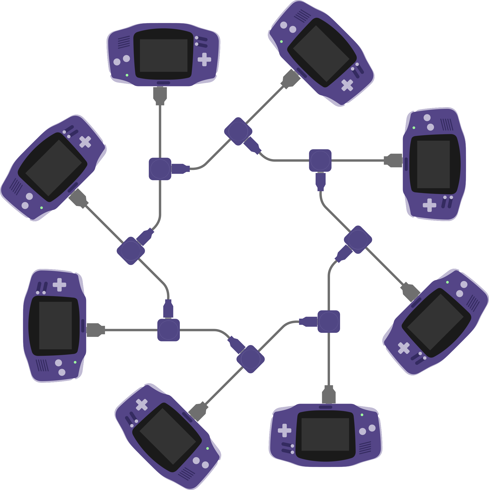

# mGBA Ring Link Support

A mod that adds experimental network ring topology support, to link more than 4 GBAs together.

## Disclaimer

This project was developed predominantly using OpenAI's Sol 6.1 (Medium) using the Codex harness.
All AI-generated commits have been explicitly labeled via GitHub's co-author feature to provide clear attribution.
I have skimmed the generated code and found it to be reasonable.
Since mGBA does not support AI-generated contributions and no commercial games use this functionality, this code will not be submitted as a PR to the mainline project.
This README is entirely human-generated.

## Features
- Adds support for up to 16 GBAs to link together using an unconventional network ring topology, inspired by [Faceball2000DX](https://github.com/Zarithya/Faceball2000DX) and [DoubleCherryGB](https://github.com/Zarithya/doublecherryGB-libretro).
  - Currently only supports the [Mario Kart: Super Circuit 8-player mod](https://github.com/SMarioMan/mksc/tree/8player).
- Supports additional command line arguments to launch multiple instances quickly and easily.
- Improves link performance via improved concurrency scheduling.
- Adds an input harness for easy automated testing by scripts and AI agents.